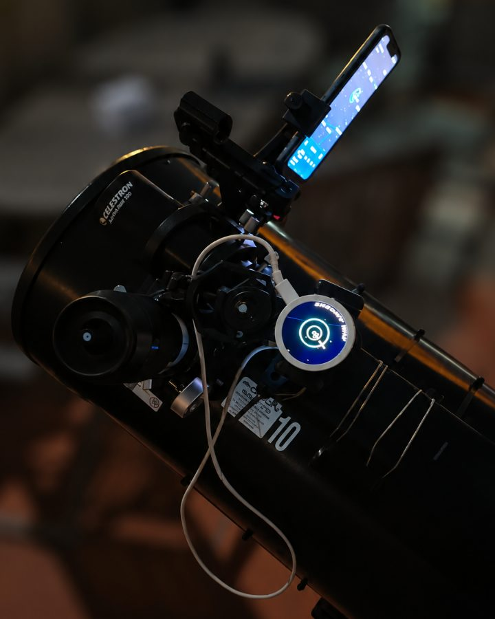
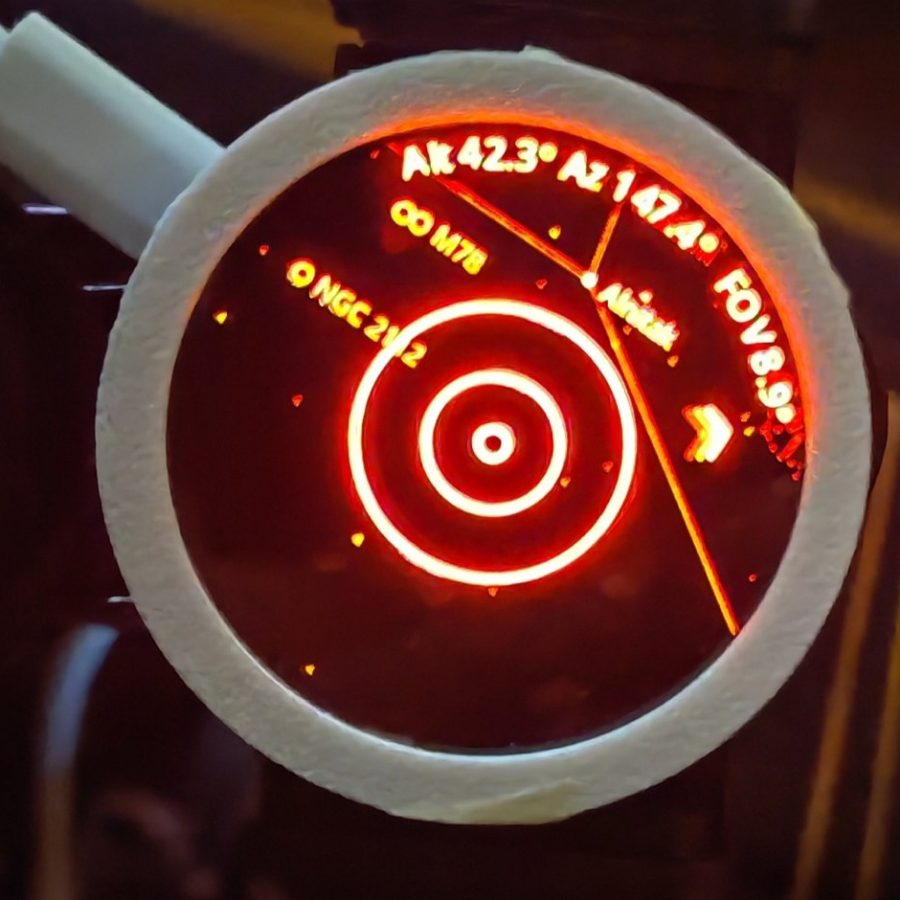

# AstroTurboMaxiPuck

Hand remote firmware for [AstroTurboMaxiSolver](https://github.com/sh3n1/AstroTurboMaxiSolver),
running on the Waveshare ESP32-S3-Touch-AMOLED-1.75. See [AGENTS.md](AGENTS.md) for the design
and [docs/screen-layout.md](docs/screen-layout.md) for the screen.

<p>
  
  
</p>

The puck by the eyepiece, the phone on the tube; and the puck in night mode.

## Tools

- [VS Code](https://code.visualstudio.com/) with the **ESP-IDF** extension
  (`espressif.esp-idf-extension`). Its setup wizard installs ESP-IDF, Python, CMake, Ninja and
  the compiler. Choose the latest stable ESP-IDF release.
- Or, without VS Code: the
  [ESP-IDF Windows installer](https://dl.espressif.com/dl/esp-idf/), then use the
  "ESP-IDF PowerShell" shortcut it creates.

## Build and flash

```sh
idf.py set-target esp32s3   # only once, or after deleting sdkconfig
idf.py build
idf.py -p COMx flash monitor
```

Replace `COMx` with the board's port (Device Manager, "Ports"). Leave the monitor with
`Ctrl+]`. If the board isn't detected, hold BOOT, press and release PWR (reset), then release
BOOT.

On Windows 11, if the build fails with "An Application Control policy has blocked this file",
Smart App Control is blocking one of ESP-IDF's unsigned tools. Turn it off in Windows Security →
App & browser control → Smart App Control settings.

### Flash from the browser

After a build, merge the bootloader, partition table and firmware into one file, in the
gitignored `dist/` folder:

```sh
cd build
python -m esptool --chip esp32s3 merge-bin -o ../dist/astroturbomaxipuck-merged.bin @flash_args
```

Flash it at offset `0x0` from Chrome or Edge with Espressif's
[ESP Tool](https://espressif.github.io/esptool-js/): Connect, choose the board's port, add the
file at `0x0`, Program. Don't erase the flash first: that would also wipe the sky catalogue
and the kept Wi-Fi networks. If `sdkconfig` sets a fallback Wi-Fi network (menuconfig, for
development only), the file holds its password: then don't share it.

## Licence

GNU GPL version 3 only (`GPL-3.0-only`). Copyright The AstroTurboMaxiSolver authors.
